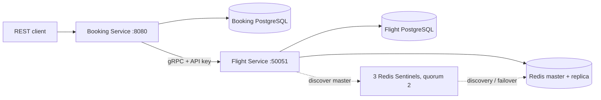

# Flight Booking — Go, gRPC, PostgreSQL, Redis Sentinel

Реализация всех десяти пунктов задания. Вся прикладная логика, HTTP/gRPC middleware,
восстановление операций и тесты написаны на Go. SQL-миграции выполняет **Flyway**.



## Запуск

Нужен Docker с плагином Compose. Из корня проекта:

```sh
docker compose up
```

Или в фоне с пересборкой и ожиданием готовности:

```sh
docker compose up --build -d --wait
docker compose ps
```

Базы сначала проходят healthcheck; два отдельных контейнера Flyway применяют
миграции; затем запускаются сервисы. Данные сохраняются в именованных volumes.
Закреплённый официальный образ `flyway/flyway:11.14.1` поддерживает ARM64,
поэтому стенд запускается на Apple Silicon без эмуляции миграций.

REST: **http://localhost:8080**, gRPC: **localhost:50051**.
PostgreSQL, Redis и Sentinel доступны только внутри сети Compose.
Healthcheck: `GET /healthz`, а для Flight — стандартный gRPC Health Check с API key.

Настройки по умолчанию позволяют запустить проект без подготовки `.env`.
При необходимости: `cp .env.example .env` и изменить значения. API key передаётся
в контейнеры через `GRPC_API_KEY`; проверяется для каждого unary gRPC-метода,
включая Health Check. Соединение использует plaintext HTTP/2 в локальной сети стенда.

Остановка с сохранением данных: `docker compose down`.
Полное удаление **данных стенда**: `docker compose down -v`.

## Пример полного сценария

Flyway добавляет три демонстрационных рейса на 1–2 апреля 2027 года.
Даты поиска трактуются как календарный день **UTC**. Без `date` ищутся все
рейсы по маршруту со статусом `SCHEDULED`.

```sh
curl -s 'http://localhost:8080/flights?origin=SVO&destination=LED&date=2027-04-01'

curl -s http://localhost:8080/flights/11111111-1111-4111-8111-111111111111

curl -s -X POST http://localhost:8080/bookings \
  -H 'Content-Type: application/json' \
  -d '{"user_id":"user-1","flight_id":"11111111-1111-4111-8111-111111111111","passenger_name":"Иван Иванов","passenger_email":"ivan@example.com","seat_count":2}'
```

Ответ создания — HTTP 201 с `Location: /bookings/{id}`:

```json
{
  "id": "<UUID из ответа>",
  "user_id": "user-1",
  "flight_id": "11111111-1111-4111-8111-111111111111",
  "passenger_name": "Иван Иванов",
  "passenger_email": "ivan@example.com",
  "seat_count": 2,
  "total_price_minor": 1100000,
  "currency": "RUB",
  "status": "CONFIRMED",
  "created_at": "2026-11-04T15:00:00Z"
}
```

Подставьте полученный UUID:

```sh
curl -s http://localhost:8080/bookings/BOOKING_ID
curl -s 'http://localhost:8080/bookings?user_id=user-1'
curl -s -X POST http://localhost:8080/bookings/BOOKING_ID/cancel
```

Суммы хранятся в целых копейках: `550000` = 5500 RUB. Цена бронирования —
неизменяемый снимок `seat_count * GetFlight.price_minor` до резервирования.
Изменение тарифа рейса не изменяет созданные бронирования. Переполнение суммы
проверяется. В JSON рейсов `int64 price_minor` представлен строкой по стандарту
Protobuf JSON; `total_price_minor` в REST-бронировании — JSON number.

## REST-контракт

| Метод | Путь | Результат |
|---|---|---|
| GET | `/flights?origin=SVO&destination=LED[&date=YYYY-MM-DD]` | 200, `{"flights":[...]}` |
| GET | `/flights/{id}` | 200, объект рейса |
| POST | `/bookings` | 201, объект бронирования |
| GET | `/bookings/{id}` | 200, объект бронирования |
| POST | `/bookings/{id}/cancel` | 200, объект со статусом CANCELLED |
| GET | `/bookings?user_id=X` | 200, `{"bookings":[...]}` |
| GET | `/healthz` | 200 при доступной Booking DB, иначе 503 |

В POST `/bookings` обязательны все пять полей из примера. ID — canonical UUID,
`user_id` — непустая строка до 128 символов, имя — до 200 символов, email —
валидный адрес до 254 байт, `seat_count` — положительный int32. Неизвестные поля,
несколько JSON-объектов и некорректные значения дают 400. Тело ограничено 16 KiB.
Пустые списки сериализуются как `[]`. Повторная отмена возвращает уже отменённую
запись и не возвращает места повторно. REST-аутентификация пользователей не входит
в контракт задания: `user_id` здесь идентификатор, переданный клиентом.

Единый формат бизнес-ошибок:

```json
{"error":{"code":"ResourceExhausted","message":"not enough available seats"}}
```

| gRPC code | HTTP |
|---|---|
| INVALID_ARGUMENT | 400 |
| NOT_FOUND | 404 |
| RESOURCE_EXHAUSTED, FAILED_PRECONDITION, ALREADY_EXISTS, ABORTED | 409 |
| UNAVAILABLE, в том числе открытый circuit breaker | 503 + Retry-After |
| DEADLINE_EXCEEDED | 504 |
| UNAUTHENTICATED / PERMISSION_DENIED между сервисами | 502 |
| INTERNAL | 500 |

## gRPC и кодогенерация

Контракт: [`api/flight/v1/flight.proto`](api/flight/v1/flight.proto).
Сгенерированный код включён в [`gen/flight/v1`](gen/flight/v1), поэтому для обычной
сборки `protoc` не нужен. Контракт содержит `Timestamp`, enum статусов,
описания бизнес-ошибок и пять операций: SearchFlights, GetFlight, ReserveSeats,
ReleaseReservation, UpdateFlight. Последний метод позволяет менять тариф и статус
и демонстрировать инвалидацию кеша. Статусы следуют переходам
`SCHEDULED → DEPARTED → COMPLETED` или `SCHEDULED → CANCELLED`.

Для повторной генерации установите protoc 33.0 и плагины в PATH:

```sh
go install google.golang.org/protobuf/cmd/protoc-gen-go@v1.36.10
go install google.golang.org/grpc/cmd/protoc-gen-go-grpc@v1.5.1
make generate
```

Пример вызова с grpcurl (контракт передаётся явно, reflection не требуется):

```sh
grpcurl -plaintext -H 'x-api-key: local-dev-service-key' \
  -import-path api -proto flight/v1/flight.proto \
  -d '{"id":"11111111-1111-4111-8111-111111111111"}' \
  localhost:50051 flight.v1.FlightService/GetFlight

grpcurl -plaintext -H 'x-api-key: local-dev-service-key' \
  -import-path api -proto flight/v1/flight.proto \
  -d '{"id":"11111111-1111-4111-8111-111111111111","priceMinor":"650000","status":"SCHEDULED"}' \
  localhost:50051 flight.v1.FlightService/UpdateFlight
```

Без `x-api-key` или с неверным ключом каждый метод отвечает `UNAUTHENTICATED`.

## Транзакции и восстановление

ER-диаграмма и обоснование 3NF: [`docs/er.md`](docs/er.md).

* **ReserveSeats:** advisory lock на `booking_id`, проверка повторного запроса,
  `SELECT ... FOR UPDATE` строки рейса, уменьшение мест, INSERT резервации и смена
  версии кеша — одна транзакция Flight DB. Недостаток мест даёт RESOURCE_EXHAUSTED.
* Один `booking_id` с теми же параметрами возвращает ту же ACTIVE-резервацию;
  другие параметры дают ALREADY_EXISTS; повтор после освобождения — FAILED_PRECONDITION.
* **ReleaseReservation:** тот же advisory lock, блокировка рейса, возврат мест,
  статус RELEASED и смена версии кеша — одна транзакция. Повтор безопасен.
* **Booking:** GetFlight → сохранение намерения в журнал → ReserveSeats →
  INSERT CONFIRMED и завершение журнала в одной транзакции Booking DB.
  Ошибка резервирования не создаёт бронирование. Ошибка INSERT/COMMIT запускает
  компенсацию ReleaseReservation.
* Журнал `booking_operations` сохраняется **до** удалённой мутации. Фоновый worker
  каждые 5 секунд восстанавливает операции: незавершённый CREATE без бронирования
  освобождает места, CANCEL повторяет освобождение и фиксирует CANCELLED. Для
  PENDING CREATE предусмотрен период 30 секунд. Блокировки строк журнала исключают
  одновременную обработку worker и HTTP-handler. При неопределённом исходе COMMIT
  worker сначала проверяет наличие бронирования и не освобождает его места.
* Release для ещё неизвестного `booking_id` сохраняет cancellation fence.
  Поэтому поздний Reserve после таймаута не может заново занять уже возвращённые
  места. Fence и резервация защищены одной блокировкой.

Две независимые БД не имеют общей ACID-транзакции: при недоступности Flight Service
компенсация ожидает восстановления связи. Durable saga обеспечивает последующее
устранение незавершённых изменений и после перезапуска Booking Service. Если
ошибка случилась при отмене, сохранённый CANCEL также будет завершён worker.
Повтор POST `/bookings` считается новым клиентским запросом; идемпотентность по
заданию обеспечивается для gRPC-мутаций по `booking_id`.

## Кеш и Sentinel

Cache-Aside: сначала версия данных из PostgreSQL, затем Redis, при miss — чтение
данных из БД и SET с TTL 5 минут (настраивается в пределах 5–10 минут).
Логи содержат `cache hit`, `cache miss` и `cache invalidated`.

Ключи: `v{generation}:flight:{id}` и
`v{generation}:search:{origin}:{destination}:{date|all}`. Версия читается вместе
с данными в read-only REPEATABLE READ snapshot. Любая мутация атомарно увеличивает
версию в PostgreSQL. Старые ключи логически инвалидируются и удаляются по TTL.
Чтение, начатое после завершения мутации, использует новую версию.

Такой подход защищает и от записи устаревшего значения конкурентным читателем,
и от потери Redis-инвалидации при failover. Цена решения — короткое обращение
к PostgreSQL за версией на каждый запрос и глобальная смена namespace для всех
рейсов. Данные из кеша не используются для проверки доступности мест.
При недоступности Redis запросы продолжают выполняться через PostgreSQL.

Sentinel: master + replica + **три Sentinel с quorum 2**. Клиент Go использует
`redis.NewFailoverClient`, обнаруживает текущий мастер и переподключается после
failover. Изменяемые конфигурации и данные Redis/Sentinel хранятся в отдельных
volumes, чтобы сохранить назначенные роли после перезапуска контейнеров.

## Retry и circuit breaker

Порядок client interceptors: **Circuit Breaker → Retry → API key → gRPC**.
Одна логическая ошибка после всех попыток учитывается breaker один раз.
Встроенный retry gRPC отключён. Максимум **три попытки**, паузы 100 и 200 ms;
каждая попытка имеет отдельный deadline 1 s. Повторяются только UNAVAILABLE и
DEADLINE_EXCEEDED. Контекст клиента прерывает ожидания и последующие попытки.

Breaker общий для клиента Flight Service. После пяти последовательных временных
ошибок в окне 30 s он переходит CLOSED → OPEN. В OPEN сразу возвращается 503 без
вызова сети. Через 10 s допускается один пробный запрос (HALF_OPEN); остальные
запросы отклоняются. Успешный ответ или бизнес-ошибка доступного сервиса закрывает
breaker, временная ошибка снова открывает его. Переходы записываются в JSON-лог.

| Переменная | По умолчанию |
|---|---|
| `GRPC_API_KEY` | `local-dev-service-key` |
| `CACHE_TTL` | `5m` |
| `GRPC_ATTEMPT_TIMEOUT` | `1s` |
| `GRPC_RETRY_BACKOFF` | `100ms` |
| `CB_FAILURE_THRESHOLD` | `5` |
| `CB_WINDOW` | `30s` |
| `CB_OPEN_TIMEOUT` | `10s` |

Параметры проверяются при запуске. Общий deadline REST-запроса — 15 s.

## Проверки

```sh
go test -race ./...
go vet ./...
docker compose --profile test run --build --rm integration
```

Unit-тесты проверяют retry, deadlines, отмену контекста, переходы breaker,
единственный HALF_OPEN probe при конкурентных запросах, аутентификацию,
валидацию REST и отображение ошибок. Интеграционные тесты работают с настоящими
PostgreSQL, gRPC, REST и Redis: гонка 30 покупателей за последним местом,
конкурентные идемпотентные Reserve/Release, rollback после ошибки INSERT,
цена-снимок, полный REST-сценарий, TTL/инвалидация, обход недоступного Redis,
компенсация потерянного ответа и ошибки Booking DB, восстановление после сбоя,
переключение мастера Sentinel и переподключение Go-клиента.
Тесты создают собственные рейсы, очищают их и не изменяют демонстрационные данные.
Проверка Sentinel переключает текущий мастер.

Ручная демонстрация breaker:

```sh
docker compose stop flight
```

Выполнить поиск рейсов не менее шести раз. После порога в логах Booking виден
`CLOSED → OPEN`, последующие запросы быстро возвращают 503. Затем:

```sh
docker compose start flight
docker compose logs --tail=80 booking
```

Через 10 секунд следующий запрос вызовет пробу и закроет breaker.

Для автоматического failover при отказе **на свежем стенде**:

```sh
docker compose stop redis-master
docker compose exec sentinel-1 redis-cli -p 26379 SENTINEL get-master-addr-by-name flightmaster
```

Через несколько секунд адрес мастера должен смениться на redis-replica. REST
продолжает работать во время переключения благодаря обходу недоступного кеша.
`docker compose start redis-master` возвращает узел, Sentinel назначает ему роль
реплики. После интеграционного теста роли уже могли поменяться: текущий мастер
определяется командой Sentinel перед остановкой.
