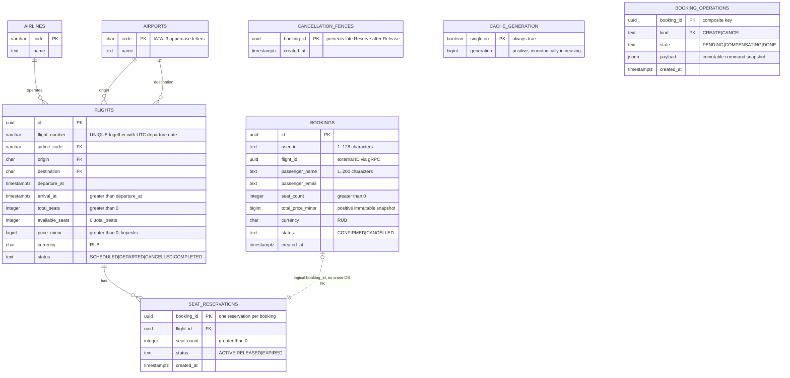

# ER-диаграмма и 3NF

Таблицы `airlines`, `airports`, `flights`, `seat_reservations`,
`cancellation_fences`, `cache_generation` принадлежат **Flight DB**.
`bookings`, `booking_operations` — **Booking DB**. Пунктир — логическая связь,
которая проверяется протоколом и не является внешним ключом между базами.

* Все значения предметных атрибутов атомарны, повторяющихся групп нет (1NF).
* Атрибуты зависят от целого первичного ключа. У журнала составной ключ
  `(booking_id, kind)`; состояние и команда относятся к конкретной операции (2NF).
* Названия авиакомпаний и аэропортов вынесены в справочники. Рейс хранит ссылки
  на них, поэтому отсутствуют зависимости `flight_id → airline_code → airline_name`
  внутри таблицы рейсов (3NF).
* В Booking DB не копируются маршрут, авиакомпания, время вылета и текущий тариф.
  Данные пассажира — атрибуты конкретного бронирования: один пользователь может
  бронировать билеты для разных пассажиров. `total_price_minor` — исторический
  снимок сделки, а не производная от текущей записи другой БД. Отдельная цена
  за место в бронировании не дублируется.
* JSONB журнала — сериализованный неизменяемый документ команды для восстановления;
  таблица журнала не используется как источник актуальных данных бронирования.
* `available_seats` — требуемый заданием счётчик агрегата. Его согласованность с
  ACTIVE-резервациями поддерживается единой транзакцией и блокировкой рейса.

Ограничения CHECK контролируют количество мест, положительную цену, статусы,
разные аэропорты, порядок времени и формат IATA. Уникальный индекс
`(flight_number, (departure_at AT TIME ZONE 'UTC')::date)` обеспечивает уникальность
номера рейса в пределах календарного дня без хранения производного столбца даты.
Внешние ключи внутри Flight DB обеспечивают целостность справочников и резерваций.
`booking_id` — PK резервации, поэтому дубликат невозможен на уровне БД.

Статус EXPIRED предусмотрен контрактом и схемой; автоматическое истечение
резерваций не входит в сценарии задания. ACTIVE сохраняется до отмены.
Служебная резервация после компенсации может существовать без Booking:
это RELEASED-запись аудита неуспешной попытки. Fence может существовать без
резервации, если отмена опередила поздний запрос ReserveSeats.
